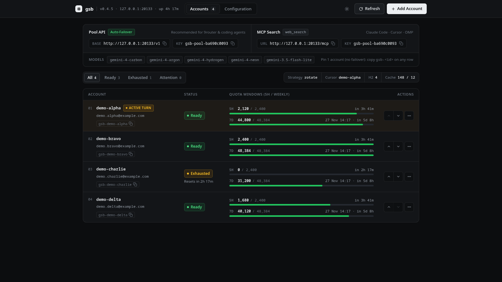

# gemini-stealth-bridge (`gsb`)

[](https://github.com/azrinaldi/gemini-stealth-bridge/releases/latest)
[](https://github.com/azrinaldi/gemini-stealth-bridge/actions/workflows/release.yml)
[](go.mod)
[](LICENSE)
[](https://github.com/azrinaldi/gemini-stealth-bridge/pkgs/container/gemini-stealth-bridge)

OpenAI-compatible HTTP proxy for [Gemini Web](https://gemini.google.com/app). Use your Google account with OpenAI SDKs, routers (`9router`), and coding agents via **Chat Completions**, **Responses**, **Image/Video Generation**, and a built-in **MCP Search server** — with multi-account pooling, quota-aware failover, and an embedded Web Control Plane.



> **Unofficial.** `gsb` authenticates with Google session cookies over a browserless uTLS/HTTP2 transport (no headless Chrome at runtime). Upstream changes, sign-in checks, and account quotas can change without notice.

---

## Features

| Feature | Description |
|---|---|
| **Chat & Responses API** | `POST /v1/chat/completions` and `POST /v1/responses` (JSON & SSE), reasoning effort (`low`/`medium`/`high`), vision inputs, and session continuation caching |
| **Function Calling** | Prompt-based tool calling with JSON Schema validation, automatic type coercion, and protection against mid-stream tool block leaks |
| **Account Pool & Failover** | Automatic rotation (`rotate`, `lru`, `fill-first`) across Google accounts with 5-hour and 7-day weekly quota tracking, group keys, and per-account proxies |
| **Native Image & Video** | Imagen / Nano Banana images and Veo MP4 videos via `/v1/images/generations`, `/v1/videos/generations`, or agent `generate_media` tool calls, served at `/v1/media/<id>` |
| **Web Search & MCP** | Appends Google Search citations (`Sources:`) and exposes `web_search` over Streamable HTTP MCP at `POST /mcp` |
| **Web Control Plane** | Embedded dashboard at `GET /ui` for account onboarding, live quota bars, priority ordering, and runtime settings |

---

## What's New in v0.4.5

- **Reliable multi-account & browser login**: Preserves full Google session cookies (`OSID` / `LSID`) on multi-account profiles and waits for the Gemini Web session to settle before closing the login browser.
- **Safer cookie rotation**: Failed or rate-limited background rotations no longer overwrite active session cookies, and rejected sessions immediately report `expired`.
- **Cleaner tool calling**: Prevents fenced `tool_calls` blocks from leaking into plain-text answers on long agent turns and deduplicates repeated tool calls.
- **Stronger stream & failover recovery**: Detects mid-stream stalls across the full response, drops stuck continuation sessions, and fails over across pool accounts on transport or upload errors.
- **Redesigned Web UI & `--desktop-ui`**: Refreshed `/ui` dashboard with Pool/MCP quick-connect cards, account priority ordering, and single-port desktop browser login forwarding (`gsb --desktop-ui`) for headless VPS servers.

---

## Quick Start

### 1. Install

```sh
# Prebuilt binary (linux_amd64, linux_arm64, darwin_amd64, darwin_arm64, windows_amd64.exe, windows_arm64.exe)
curl -fL -o gsb https://github.com/azrinaldi/gemini-stealth-bridge/releases/latest/download/gsb_linux_amd64
chmod +x gsb

# Or build from source (requires Go 1.26+)
go build -o gsb ./cmd/gsb
```

### 2. Sign In & Verify

```sh
./gsb --login acc1
./gsb --probe
```

### 3. Start the Server

```sh
./start.sh
# or directly:
./gsb --web
```

- **OpenAI Base URL**: `http://127.0.0.1:20133/v1`
- **MCP Endpoint**: `http://127.0.0.1:20133/mcp`
- **Web Control Plane**: `http://127.0.0.1:20133/ui`

### 4. Send a Request

```sh
curl -sS http://127.0.0.1:20133/v1/chat/completions \
  -H 'Authorization: Bearer public' \
  -H 'Content-Type: application/json' \
  -d '{"model":"gemini-4-hydrogen","messages":[{"role":"user","content":"Reply with OK."}]}'
```

---

## Onboarding & Headless VPS

- **Local isolated browser (recommended)**: `./gsb --login <name>` opens a temporary browser profile, captures the session on sign-in, and verifies it before saving.
- **Headless VPS with local desktop browser (`--desktop-ui`)**:
  ```sh
  # On laptop (forwards VPS 127.0.0.1:20133 over a private SSH socket and serves local :20133):
  install -d -m 700 "$XDG_RUNTIME_DIR/gsb-desktop"
  ssh -NT -o ExitOnForwardFailure=yes -o StreamLocalBindMask=0177 -o StreamLocalBindUnlink=yes \
    -L "$XDG_RUNTIME_DIR/gsb-desktop/bridge.sock:127.0.0.1:20133" user@vps
  gsb --desktop-ui
  ```
  Open `http://127.0.0.1:20133/ui` and click **+ Add Account → Launch**.
- **Incognito cookie paste**: Sign in via a new Incognito window, export cookies (Cookie-Editor JSON or `Cookie` header), **close the Incognito window immediately without signing out**, and paste into **+ Add Account** or `./gsb --import-cookie <name> < cookies.json`.
- **Existing signed-in profile**: `./gsb --import-chrome <name> --chrome-profile "Profile 1"`.

---

## Client Integration

### API Keys

| Key | Value | Behavior |
|---|---|---|
| **Pool key** | `BRIDGE_API_KEY` (default `public`) | Automatic routing & failover across all healthy accounts *(recommended)* |
| **Group key** | `BRIDGE_GROUP_TOKENS` (`token:group`) | Failover scoped to accounts in one group (`BRIDGE_ACCOUNT_GROUP`) |
| **Account key** | `gsb-<name>` or `BRIDGE_ACCOUNT_TOKENS` | Pins traffic to a single account (no failover) |

### Routers & Agents

- **`9router` / Coding Agents**: Point a single provider to `http://127.0.0.1:20133/v1` using the **pool key**. Model IDs come from `GET /v1/models` and accept `gsb/`, `google/`, `models/` prefixes plus `@think=low|medium|high`.
- **MCP (`web_search`)**:
  ```json
  {
    "mcpServers": {
      "gemini-search": {
        "type": "http",
        "url": "http://127.0.0.1:20133/mcp",
        "headers": { "Authorization": "Bearer public" }
      }
    }
  }
  ```

---

## Endpoints

| Method | Path | Purpose |
|---|---|---|
| `GET` | `/ui` | Web Control Plane |
| `GET` | `/health`, `/readyz` | Liveness and account readiness (`?strict=1`) |
| `GET` | `/v1/models` | Live model catalog and capabilities (`?fresh=1`) |
| `POST` | `/v1/chat/completions` | OpenAI Chat Completions (JSON / SSE) |
| `POST` | `/v1/responses` | OpenAI Responses API (JSON / SSE) |
| `POST` | `/v1/images/generations` | Native image generation (`url` or `b64_json`) |
| `POST` | `/v1/videos/generations` | Native Veo MP4 video generation |
| `GET` | `/v1/media/<id>` | Local proxy for generated images and videos |
| `POST` | `/mcp`, `/v1/mcp` | Streamable HTTP MCP server (`web_search`) |
| `GET` | `/v1/accounts`, `/v1/quota`, `/v1/sessions` | Pool status, 5h/7d quotas (`?live=1`), and active sessions |
| `POST` | `/v1/refresh` | Reload account files and refresh models |

---

## Configuration

Settings load from environment variables, then `$BRIDGE_HOME/config.env`, then defaults:

| Variable | Default | Description |
|---|---|---|
| `BRIDGE_HOST` / `BRIDGE_PORT` | `127.0.0.1` / `20133` | Listen address and port |
| `BRIDGE_HOME` | `~/.gemini-stealth-bridge` | Data directory for `accounts/`, `config.env`, and `session-cache.json` |
| `BRIDGE_API_KEY` / `BRIDGE_ADMIN_KEY` | `public` / empty | Pool API key and admin key for remote `/ui` & `/v1/admin/*` |
| `BRIDGE_WEB_UI` | `false` (`1` in `start.sh`/Docker) | Enable `/ui` and `/v1/admin/*` |
| `BRIDGE_ACCOUNT_STRATEGY` | `rotate` | Pool routing strategy: `rotate`, `lru`, or `fill-first` |
| `BRIDGE_ACCOUNT_PRIORITY` | empty | Comma-separated account order for `fill-first` and UI ranking |
| `BRIDGE_QUOTA_PREFLIGHT` | `strict` | Skip spent accounts (`strict`, `advisory`, `off`) |
| `BRIDGE_DEFAULT_THINKING` | `low` | Default thinking effort (`low`, `medium`, `high`) |
| `BRIDGE_MAX_RPM_PER_ACCOUNT` | `24` | Rolling-minute request limit per account (`0` disables) |
| `BRIDGE_MAX_CONCURRENT_PER_ACCOUNT` | `2` | Max concurrent streams per account (`0` disables) |
| `BRIDGE_REJECT_DOWNGRADE` | `true` | Reject silent upstream model substitution and fail over |
| `BRIDGE_PROXY_SERVER` / `BRIDGE_EGRESS_PER_ACCOUNT` | empty | Global or per-account (`id:url`) HTTP/SOCKS5 proxy |
| `BRIDGE_MEDIA_PLAIN_FETCH` | `false` | Experimental standard HTTP media downloads; preserves account egress and leaves generation on uTLS |

---

## Docker & CLI

```sh
# Docker Compose (set BRIDGE_ADMIN_KEY because container NAT appears remote)
BRIDGE_ADMIN_KEY=$(openssl rand -hex 24) docker compose up -d
```

Common CLI commands:

```sh
./gsb --login <name>              # Interactive isolated browser login
./gsb --probe                     # Verify accounts, models, and quota
./gsb --accounts --accounts-live  # Live account status & 5h/weekly quota table
./gsb --desktop-ui                # Local one-port UI/API proxy for a remote VPS
./gsb --login-helper              # Local browser login helper on 127.0.0.1:20134
./gsb --check-config              # Validate environment configuration
```

For deep operational details and troubleshooting, see [`AGENTS.md`](./AGENTS.md).

---

## License

[MIT](./LICENSE)
